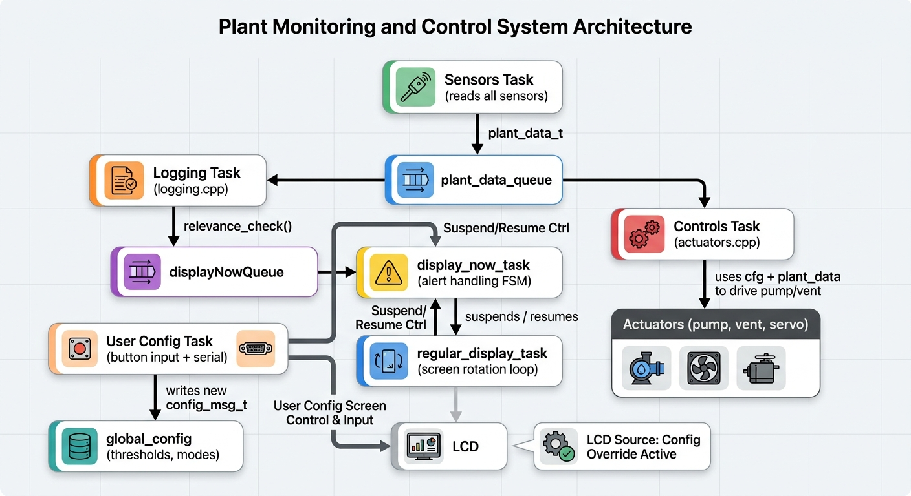

# 🌿 Plant Monitoring and Control System

---

## 🧩 Overview

This project implements a **real-time plant monitoring and control system** on an **ESP32-S3** microcontroller using **FreeRTOS**.  
It continuously reads environmental data, logs sensor values, displays status information, and controls actuators such as a pump, vent, and servo based on configurable thresholds.

The system architecture emphasizes **task isolation**, **queue-based communication**, and **fault-tolerant operation**.  
Each subsystem runs as an independent FreeRTOS task, coordinated through shared queues and configuration structures.

---

## 🏗️ System Architecture

### Core Components

| Subsystem | Description |
|-----------|-------------|
| **Sensors Task** | Reads all sensors (temperature, humidity, light, moisture, sound, height) and publishes data to `plant_data_queue`. |
| **Controls Task** | Uses `global_config` and `plant_data_t` to drive actuators (pump, vent, servo) based on threshold or schedule mode. |
| **Logging Task** | Logs sensor data, performs relevance checks, and triggers alerts via `displayNowQueue`. |
| **Display Tasks** | `regular_display_task` rotates screens; `display_now_task` handles alerts and suspends rotation when active. |
| **User Config Task** | Handles button input and serial commands to update configuration parameters (`config_msg_t`). |
| **Global Config** | Stores thresholds, modes, and timing parameters shared across all tasks. |

---

## ⚙️ Features

- **Multi-tasking architecture** using FreeRTOS  
- **Sensor fusion** for environmental monitoring  
- **Hysteresis-based watering control**  
- **Fault detection and persistent alerts**  
- **Configurable thresholds via UI wizard**  
- **LCD display with alert override**  
- **Modular codebase** (`sensors.cpp`, `actuators.cpp`, `controls.cpp`, `logging.cpp`, `globals.cpp`)  

---

## 🧠 Task Interaction Summary

| Task | Input | Output | Notes |
|------|-------|--------|-------|
| **Sensors Task** | Hardware sensors | `plant_data_queue` | Runs at 50 Hz |
| **Controls Task** | `global_config`, `plant_data_queue` | Actuator commands | Drives pump/vent |
| **Logging Task** | `plant_data_queue` | `displayNowQueue` | Triggers alerts |
| **Display Tasks** | `displayNowQueue`, `global_config` | LCD output | Handles alerts and rotation |
| **User Config Task** | Button ISR, serial input | `global_config` | Updates thresholds/modes |

---

## Hardware Schematic 
                         ┌──────────────────────────┐
                         │   ESP32‑S3 DevKitC‑1     │
                         │                          │
                         │ 3V3 ───────────────┐     │
                         │ 5V  ───────────────┐     │
                         │ GND ───────────────┴──┐  │
                         │                        │  │
                         │ SDA (21)───────────────┼──┼── AM2320 (3.3V)
                         │ SCL (20)───────────────┼──┼── LCD1602 I²C (5V)
                         │                        │  │
                         │ TRIG (7)───────────────┼──┼── HC‑SR04 (5V)
                         │ ECHO (15)──────────────┼──┘
                         │                        │
                         │ LIGHT (1)──────────────┼─── LDR divider (3.3V)
                         │ SOUND (2)──────────────┼─── Sound sensor (5V)
                         │ MOIST (19)─────────────┼─── Moisture sensor (3.3V)
                         │                        │
                         │ SERVO (11)─────────────┼─── Servo (5V)
                         │                        │
                         │ IN1 (16)───────────────┼─── ULN2003 Stepper Driver (5V)
                         │ IN2 (17)───────────────┼───
                         │ IN3 (18)───────────────┼───
                         │ IN4 (8)────────────────┼───
                         │                        │
                         │ BTN_UP (6)─────────────┼─── Button → GND
                         │ BTN_DOWN (4)───────────┼─── Button → GND
                         │ BTN_ENTER (5)──────────┼─── Button → GND
                         └──────────────────────────┘

Breadboard rails:
- Left red rail  = 3.3V
- Right red rail = 5V
- Blue rails     = GND (tied together)

---

## 🧾 License

This project is released under the MIT License.  
Feel free to use, modify, and build upon it for educational or research purposes.

---

## 👤 Author

**C.V. Hunt**  
EE 474 — Introduction to Embedded Systems  
University of Washington, Summer 2026
